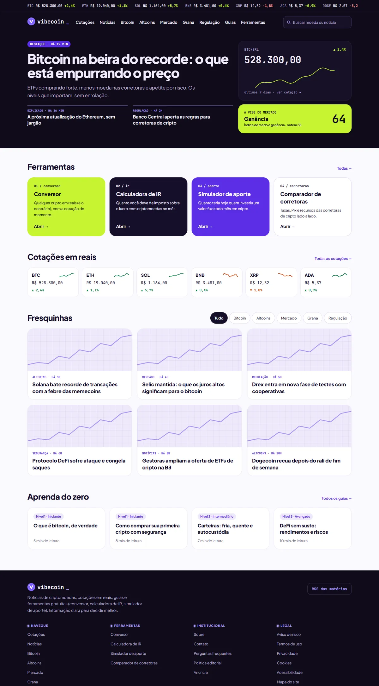
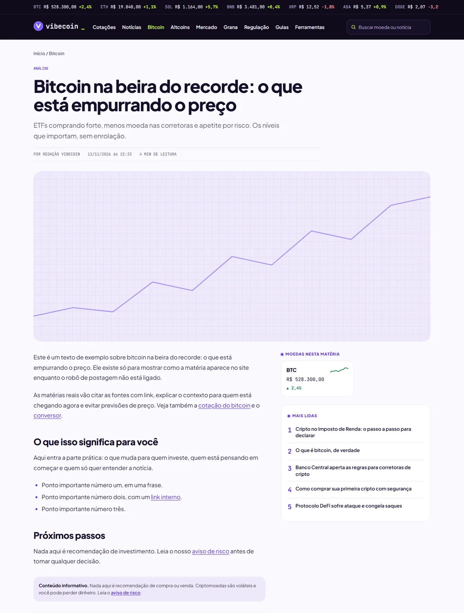
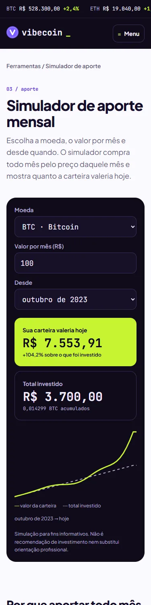

# Vibecoin

**Cripto e finanças em reais, sem jargão.**

Notícias de criptomoedas, cotações em reais e ferramentas gratuitas — conversor, calculadora de
imposto de renda, simulador de aporte e comparador de corretoras — num site que se escreve sozinho.

**vibecoin.com.br** · em desenvolvimento

> [!IMPORTANT]
> **Todos os direitos reservados.**
> O código está público apenas para leitura. Não é um projeto open source:
> não é permitido copiar, redistribuir, publicar outra versão do site nem reaproveitar o código, o
> visual ou os textos, no todo ou em parte. Veja [LICENSE](LICENSE).

## O que é

O Vibecoin é um site brasileiro sobre criptomoedas e finanças pessoais. Ele explica o que acontece no
mercado em português claro, mostra os preços em reais e oferece ferramentas que fazem a conta pelo
leitor. O conteúdo será produzido por um pipeline editorial automático, no mesmo modelo do
[Respawnou](https://github.com/evssousa/respawnou), o portal de games irmão.

### Destaques

- **Ferramentas que fazem a conta** — conversor cripto ↔ reais, calculadora de IR (isenção de
  R$ 35 mil e alíquotas progressivas), simulador de aporte mensal com gráfico e comparador de
  corretoras. Tudo no navegador, sem cadastro.
- **Cotações em reais** — tabela de mercado com variação em 24 h e 7 dias, minigráficos e uma
  página por moeda ligada às notícias que a citam.
- **Design próprio "Dia e Noite"** — topo escuro com cara de terminal (roxo-noite e lima) e corpo
  claro para leitura confortável; escolhido entre 16 protótipos. Responsivo de 375 px a telas largas.
- **Responsável por padrão** — aviso de risco em toda matéria e ferramenta, nenhuma previsão de
  preço, fontes sempre creditadas e alta/queda indicadas por seta, não só por cor.
- **SEO e monetização prontos** — SSR, dados estruturados, sitemap e RSS dinâmicos, páginas vazias
  fora do índice, AdSense com Modo de Consentimento v2 ligado por uma única variável.

## Telas

| Matéria | Celular | Simulador de aporte |
|---|---|---|
|  |  |  |

As telas usam dados de exemplo (preços e notícias fictícios).

## Stack

| Camada | Tecnologia |
|---|---|
| Frontend | React 19, React Router 8 (modo framework, SSR), Tailwind CSS 4, TypeScript |
| Servidor | Node.js, Express 5 |
| Banco | MySQL (`mysql2`), migrations SQL versionadas e aplicadas no start |
| Dados de mercado | CoinGecko (cotações e histórico), alternative.me (medo e ganância) |
| IA | Google Gemini |
| Hospedagem | Hostinger (app Node.js + MySQL + Cron Jobs), deploy automático a cada push |

## Decisões técnicas

O registro completo está em [`docs/decisoes.md`](docs/decisoes.md). Alguns exemplos:

- **Uma camada de dados, duas fontes.** As páginas não sabem se os dados vêm do MySQL ou dos dados
  de exemplo, o que permite construir o frontend inteiro antes do banco.
- **Ferramenta sem dados não aparece.** Conversor, simulador e comparador só entram no menu, na home e
  no sitemap quando têm cotações, histórico e corretoras de verdade.
- **Regra fiscal com data.** A calculadora de IR mostra quando a regra foi conferida pela última vez —
  lei muda, e o leitor precisa saber até quando a conta vale.
- **Nada de formulário de enfeite.** A newsletter do protótipo só entra quando existir o serviço de
  e-mail; até lá, o rodapé oferece o RSS.

## Documentação

A pasta [`docs/`](docs/README.md) tem o status do projeto e os detalhes de cada parte:
[arquitetura](docs/arquitetura.md) · [ferramentas](docs/ferramentas.md) · [decisões](docs/decisoes.md)

## Licença

© 2026 Vibecoin. **Todos os direitos reservados.** Este repositório é público só para leitura.
Nenhuma licença de uso, cópia, modificação ou distribuição é concedida. Marcas e nomes de
criptomoedas, empresas e projetos citados pertencem aos seus donos. Detalhes em [LICENSE](LICENSE).
